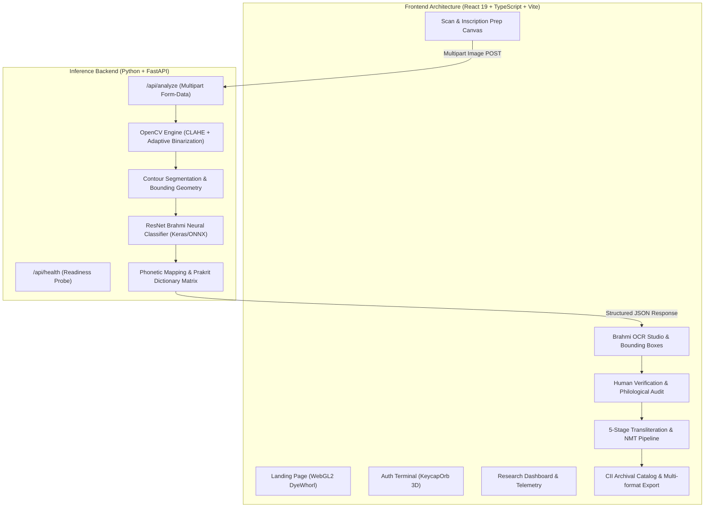

<div align="center">

# 𑀮𑀺𑀧𑀺𑀓𑀸 • LIPIKA AI
### *Preserving the Past. Decoding the Future.*
**An AI-Assisted Epigraphical Workbench & Neural OCR Pipeline for Ancient Indian Brahmi Inscriptions**

[](https://react.dev/)
[](https://fastapi.tiangolo.com/)
[](https://opencv.org/)
[](https://tailwindcss.com/)
[](https://www.khronos.org/webgl/)
[](https://epidoc.stoa.org/)
[](LICENSE)

<br />

[Explore Features](#-key-capabilities) •
[System Architecture](#-system-architecture) •
[Quickstart](#-quickstart-guide) •
[API Specification](#-api-reference) •
[Epigraphical Corpus](#-historical-corpus-coverage) •
[Citation](#-scholarly-citation)

</div>

---

## 🏛️ Abstract & Project Overview

**Lipika AI** (लिपि-का, derived from Sanskrit *lipi* meaning "script" or "writing") is an end-to-end digital epigraphy research workbench engineered to digitize, segment, classify, transliterate, and contextually interpret ancient Indian inscriptions.

**The Brahmi script** (c. 3rd century BCE – 5th century CE) represents the mother script of virtually all indigenous writing systems across South and Southeast Asia, including Devanagari, Bengali, Tamil, Telugu, Kannada, Tibetan, and Burmese. Despite containing foundational documentation of Indian political, religious, and economic history (such as Emperor Ashoka’s Rock & Pillar Edicts), thousands of inscriptions preserved in museums and archaeological sites remain inaccessible, uncataloged, or physically degrading due to environmental erosion.

Lipika AI bridges **computational computer vision**, **convolutional neural networks (CNNs)**, and **human-in-the-loop philological verification** to transform weathered stone rubbings into publication-grade, machine-readable digital editions compliant with international **EpiDoc TEI-XML** standards.

---

## ✨ Key Capabilities

### 1. 🌊 Fluid Simulation Landing Experience
* Built with an inline **WebGL2 Navier-Stokes incompressible fluid solver** (`DyeWhorl`).
* Simulates real-time ink plume dispersion in still water with semi-Lagrangian advection, Jacobi pressure projection, vorticity confinement, and pointer turbulence.
* Reflects the physical metaphor: *ancient ink and stone brought into fluid digital life*.

### 2. ⌨️ 3D Physics Keycap Auth Terminal
* Features an interactive **3D mechanical keycap sphere** (`KeycapOrb`) with angular momentum, hover displacement physics, and keystroke ripples.
* High-contrast monochrome aesthetic with instantaneous toggle between carbon/ash research finishes.
* **1-Click Evaluator Demo Access**: Allows academic reviewers and hackathon judges to immediately launch the full research workbench without credential hurdles.

### 3. 🔍 Multispectral Preprocessing & Stone Rubbing Filters
* Integrated canvas controls for digital rubbing enhancement:
  - Contrast Limited Adaptive Histogram Equalization (**CLAHE**).
  - Laplacian kernel high-frequency stroke sharpening.
  - Inverted binarization for white-on-black squeeze paper rubbings.
  - Interactive multi-zoom (75%–300%), smooth drag panning, and region cropping.

### 4. 🔲 Contour Segmentation & Spatial Bounding Matrix
* OpenCV contour extraction detects character bounding boxes across irregular stone surfaces.
* Computes normalized geometric coordinates `(x, y, w, h)` across the inscription plane.
* Handles complex conjuncts, vowel signs (*matras* `U+11038`–`U+11045`), and damaged lacuna zones.

### 5. 🧠 ResNet Neural Brahmi Character Classifier
* Deep convolutional model classifies segmented glyphs directly into the Unicode Brahmi block (`U+11000`–`U+1107F`).
* Calculates softmax confidence distribution and top ranked alternatives for degraded glyphs.
* Generates paired International Alphabet of Sanskrit Transliteration (**IAST**) and Devanagari equivalents.

### 6. 🛡️ Human-in-the-Loop Philological Audit Studio
* **Scholarly Integrity Principle**: AI outputs are probabilistic hypotheses, never automatically asserted as academic gospel truth.
* 3-panel review terminal: **[Original Stone Crop]** vs. **[AI Softmax Prediction]** vs. **[Ranked Alternative Candidates]**.
* Actions: `Accept`, `Select Alternative`, `Manual Character Override`, and `Mark Uncertain / Lacuna`.
* Reviewer sign-off recording philological reasoning and epigraphist identity.

### 7. 📜 5-Stage Interpretation Pipeline
* **Stage 1**: Verified Brahmi Unicode character stream.
* **Stage 2**: Standardized phonetic transliteration (IAST & Devanagari) + lexical word-by-word breakdown.
* **Stage 3**: Authentic Hindi translation (हिंदी अनुवाद).
* **Stage 4**: Scholarly English translation with regnal nomenclature.
* **Stage 5**: Contextual historical annotation (reign, dynasty, geopolitical significance).

### 8. 📦 Publication-Grade Data Export
* Export verified records in standard digital humanities formats:
  - **TEI-XML / EpiDoc (P5 Schema)**: Standard for digital epigraphy and academic corpora.
  - **Comprehensive PDF Research Report**: Formatted with glyph plates, metrics, and translations.
  - **Structured JSON Schema**: Ready for ingestion into external databases and APIs.
  - **Plain Text / IAST Transcripts**: For quick linguistic annotation.

---

## 🏗️ System Architecture



---

## 📁 Repository Structure

```
LIPIKA-AI/
├── backend/                             # Python FastAPI Inference Engine
│   ├── app/
│   │   ├── main.py                      # Application factory & CORS configuration
│   │   ├── models/
│   │   │   └── schemas.py               # Pydantic schemas (Glyph, BoundingBox, OCRResponse)
│   │   ├── routes/
│   │   │   ├── analyze.py               # POST /api/analyze inference pipeline endpoint
│   │   │   └── health.py                # GET /api/health monitoring endpoint
│   │   └── services/
│   │       ├── cv_preprocessing.py      # CLAHE, Laplacian sharpening & binarization
│   │       ├── character_segmentation.py# Contour extraction & geometric bounding boxes
│   │       └── ocr_inference.py         # ResNet/CNN classifier & Softmax alternatives
│   ├── models/
│   │   └── README.md                    # Pretrained Brahmi weights specification
│   ├── requirements.txt                 # FastAPI, OpenCV, NumPy, Uvicorn, Pillow
│   └── test_api.py                      # Integration test suite for backend routes
│
├── frontend/                            # Modern Monochrome React Application
│   ├── public/                          # Vector brand assets & favicons
│   ├── src/
│   │   ├── components/
│   │   │   ├── reactbits/               # Animated typography, counters & transitions
│   │   │   ├── shared/                  # Header, Sidebar, MobileNav, Toast notifications
│   │   │   └── ui/                      # Monochrome primitives (DyeWhorl, KeycapOrb, ImageViewer...)
│   │   ├── data/
│   │   │   └── mockInscriptions.ts      # Authentic Corpus Inscriptionum Indicarum records
│   │   ├── hooks/
│   │   │   └── useInscriptionPipeline.ts# State machine hook for epigraphical workflow
│   │   ├── layouts/
│   │   │   └── MainLayout.tsx           # High-contrast laboratory workspace layout
│   │   ├── pages/
│   │   │   ├── Landing.tsx              # Full-bleed fluid shader landing page
│   │   │   ├── Auth.tsx                 # Split-screen 3D keycap terminal & guest access
│   │   │   ├── Dashboard.tsx            # Digital archaeology research workspace
│   │   │   ├── Analyze.tsx              # Multispectral scan & 7-stage pipeline canvas
│   │   │   ├── Results.tsx              # OCR glyph inspection & bounding box viewer
│   │   │   ├── Verification.tsx         # 3-panel human verification & correction studio
│   │   │   ├── Translation.tsx          # 5-stage vertical interpretation pipeline
│   │   │   ├── History.tsx              # CII catalog browser & TEI-XML / PDF export
│   │   │   └── About.tsx                # Technical capstone methodology & pipeline specs
│   │   ├── services/
│   │   │   ├── apiClient.ts             # Axios / fetch instance with environment baseUrl
│   │   │   ├── analysisService.ts       # Pipeline runner & error boundary
│   │   │   ├── exportService.ts         # TEI-XML, JSON, TXT & PDF report generators
│   │   │   └── translationService.ts    # Transliteration & NMT clipboard utilities
│   │   ├── types/
│   │   │   └── inscription.ts           # TypeScript interfaces for glyphs, records, TEI
│   │   ├── App.tsx                      # Client-side routing configuration
│   │   └── index.css                    # Tailwind CSS v4 design tokens (pure monochrome)
│   ├── package.json
│   ├── tsconfig.json
│   └── vite.config.ts
│
├── ml/                                  # Machine Learning Training Assets
│   └── notebooks/
│       ├── brahmi_training.ipynb        # Dataset augmentation & CNN training pipeline
│       └── Brahmi-Dataset.zip           # Sample glyph reference archive
├── .gitignore                           # Excludes venv, node_modules, dist, uploads, .env
└── README.md                            # Comprehensive project documentation
```

---

## 🏛️ Historical Corpus Coverage

Lipika AI comes pre-indexed with primary epigraphical benchmarks from the **Corpus Inscriptionum Indicarum (CII)**:

| Catalog ID | Historical Inscription | Dynasty / Reign | Period / Century | Provenance & Material |
| :--- | :--- | :--- | :--- | :--- |
| **`BR-ASH-GIR-003`** | Major Rock Edict III (Girnar) | Mauryan (Emperor Ashoka) | c. 257 BCE | Junagadh, Gujarat (Granite Rock Face) |
| **`BR-KHA-HAT-001`** | Hathigumpha Inscription | Chedi / Mahameghavahana (Kharavela) | c. 2nd–1st Cent. BCE | Udayagiri Caves, Odisha (Natural Sandstone) |
| **`BR-SHU-BES-001`** | Heliodorus Pillar Inscription | Indo-Greek / Shunga (Bhagabhadra) | c. 113 BCE | Vidisha, Madhya Pradesh (Monolithic Sandstone) |

---

## 🚀 Quickstart Guide

### Prerequisites
* **Node.js**: v18.0.0 or higher (`v20+` recommended)
* **npm**: v9.0.0 or higher
* **Python**: v3.10, v3.11, or v3.12
* **Git**: v2.30 or higher

---

### 1. Clone the Repository
```bash
git clone https://github.com/<YOUR_USERNAME>/LIPIKA-AI.git
cd LIPIKA-AI
```

---

### 2. Backend Setup (FastAPI & OpenCV)
```bash
# Navigate to backend directory
cd backend

# Create a virtual environment
python -m venv venv

# Activate virtual environment
# Windows (PowerShell):
.\venv\Scripts\Activate.ps1
# Linux / macOS:
# source venv/bin/activate

# Install required packages
pip install -r requirements.txt

# Start the FastAPI inference server
uvicorn app.main:app --reload --port 8000
```
> The backend server will be live at: **`http://localhost:8000`**  
> Interactive Swagger API docs: **`http://localhost:8000/docs`**  
> Health probe: **`http://localhost:8000/api/health`**

---

### 3. Frontend Setup (React 19 & Vite)
Open a new terminal window:
```bash
# Navigate to frontend directory
cd frontend

# Install dependencies
npm install

# Start development server
npm run dev
```
> The React research studio will be accessible at: **`http://localhost:5173`**

---

### 4. Build for Production
To create an optimized, type-checked production bundle:
```bash
cd frontend
npm run build
```

---

## 📡 API Reference

### `GET /api/health`
Health check endpoint to verify backend operational readiness.
```json
{
  "status": "healthy",
  "model_loaded": true,
  "supported_scripts": ["Ashokan Brahmi", "Kalinga Brahmi", "Shunga Brahmi"]
}
```

---

### `POST /api/analyze`
Submits an inscription image for binarization, segmentation, and neural recognition.

* **Content-Type**: `multipart/form-data`
* **Form Field**: `file` (Binary image: `.jpg`, `.jpeg`, `.png`, `.webp` up to 15MB)

#### Sample JSON Response:
```json
{
  "status": "success",
  "total_glyphs_detected": 7,
  "average_confidence": 95.8,
  "characters": [
    {
      "index": 1,
      "prediction": "𑀤",
      "phonetic_iast": "da",
      "devanagari": "द",
      "unicode_hex": "U+11024",
      "confidence": 98.2,
      "bounding_box": {
        "x": 12.4,
        "y": 34.2,
        "width": 6.8,
        "height": 11.5
      },
      "alternatives": [
        { "char": "𑀤𑀺", "iast": "di", "unicode": "U+11024+1103A", "confidence": 1.4 },
        { "char": "𑀢", "iast": "ta", "unicode": "U+11022", "confidence": 0.4 }
      ]
    }
  ],
  "raw_brahmi_line": "𑀤𑀯𑀦𑀁𑀧𑀺𑀬",
  "suggested_iast": "Devānaṁpiye",
  "processing_time_ms": 342
}
```

---

## ⚖️ Scholarly Integrity & Ethical AI Statement

Epigraphical decipherment directly impacts historical, cultural, and political narratives. Therefore, **Lipika AI** adheres to strict ethical digital humanities guidelines:

1. **Probabilistic Assistance, Not Scholarly Authority**: Neural OCR predictions are assistive tools designed to alleviate the tedium of manual character search. They are never published as authentic history without expert philological review.
2. **Epigraphical Epistemology**: The UI explicitly flags low-confidence glyphs (`<90%` doubtful, `<70%` conjectural) and visualizes secondary alternative candidates to prevent confirmation bias.
3. **Lacuna Preservation**: Weathered stones frequently exhibit missing characters (*lacunae*). The platform permits scholars to mark gaps rather than forcing artificial algorithmic completions.
4. **Transparent Provenance**: Exported publications embed the full audit trail: reviewer name, timestamp, model version, and manual override reasoning.

---

## 🛠️ Technology Matrix

| Layer | Technologies | Primary Purpose |
| :--- | :--- | :--- |
| **Frontend UI** | React 19, TypeScript, Vite | Fast, responsive single-page application |
| **Styling** | Tailwind CSS v4, Lucide Icons | High-contrast monochrome laboratory design |
| **Visual Computing** | WebGL 2.0 Shader Language | Real-time Navier-Stokes fluid plume dynamics |
| **Backend API** | FastAPI, Starlette, Pydantic v2 | High-performance asynchronous ML endpoints |
| **Computer Vision** | OpenCV 4.9, NumPy, Pillow | Adaptive CLAHE rubbing filtration & contours |
| **OCR Classifier** | Keras 3 / TensorFlow, ResNet | Brahmi glyph recognition & Softmax ranking |
| **Epigraphy Standards**| EpiDoc TEI-XML, IAST, CII | Digital humanities academic interoperability |

---

## 📜 Scholarly Citation

If you use Lipika AI in academic research, digital humanities projects, or thesis work, please cite:

```bibtex
@software{lipika_ai_2026,
  author = {Delta student and Contributors},
  title = {Lipika AI: An AI-Assisted Epigraphical Workbench & Neural OCR Pipeline for Ancient Indian Brahmi Inscriptions},
  year = {2026},
  publisher = {GitHub},
  journal = {GitHub repository},
  howpublished = {\url{https://github.com/Delta-student/LIPIKA-AI}},
  version = {1.0.0}
}
```

---

<div align="center">

Made with 🖤 for Indian Heritage & Digital Humanities Preservation.

</div>
